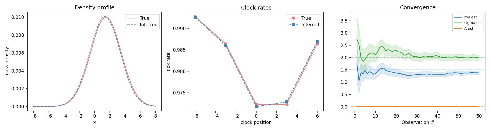

## From particles to fields

Real gravitational anomalies are rarely points — ore bodies, dense
intrusions, anything extended. The same machinery handles them: replace the
point-mass forward model with one that integrates the potential over a
continuous profile. Here that profile is a Gaussian *line* density, mass per
unit length spread along the hidden track, never negative, with three
parameters —
center $\mu$, width $\sigma$ (the profile's own width here, not the
[observation noise](../method/notation-and-glossary.qmd#term-sigma-obs) from earlier pages), and peak amplitude $A$ — and the
identical particle filter on top.



## What spreading the mass does to clocks

```{python}
#| code-fold: true
#| renderings: [light, dark]
#| fig-cap:
#|   - "A point mass vs Gaussian profiles of equal total mass at two widths. Spreading the mass flattens and broadens the dip in tick rates."
#|   - "A point mass vs Gaussian profiles of equal total mass at two widths. Spreading the mass flattens and broadens the dip in tick rates."
import matplotlib.pyplot as plt
import numpy as np
from clocks import ClockArray, MassConfig, clock_rates, clock_rates_density_gaussian
from clocks.viz import THEMES, show, style

xs = np.linspace(-8, 8, 200).reshape(-1, 1)
dense = ClockArray(positions=xs, track_offset=1.0)
total_mass = 0.02

point = MassConfig(positions=np.array([[1.5]]), masses=np.array([total_mass]))
point_rates = clock_rates(point, dense)
sigmas = (0.5, 2.0)
gaussian_rates = []
for sigma in sigmas:
    amplitude = total_mass / (sigma * np.sqrt(2 * np.pi))
    gaussian_rates.append(clock_rates_density_gaussian(
        np.array([1.5, sigma, amplitude]), dense
    ))

for theme in THEMES:
    with style(theme) as colors:
        fig, ax = plt.subplots()
        ax.plot(xs[:, 0], point_rates, label="point mass", color=colors.ink)
        for sigma, rates, color in zip(
            sigmas, gaussian_rates, (colors.ordered[0], colors.ordered[2])
        ):
            ax.plot(xs[:, 0], rates, label=f"Gaussian, σ = {sigma}", color=color)
        ax.set_xlabel("clock position")
        ax.set_ylabel("tick rate")
        ax.legend()
        show(fig)
```

## A new degeneracy

The model admits a ridge where $\sigma$ and $A$ trade off: a wider, weaker
profile and a narrower, denser one can produce nearly identical potentials at
a handful of clock positions. This is the same inverse-problem pattern as the
[mass–distance degeneracy](one-clock-is-not-enough.qmd): different physical
profiles map to nearly identical clock-rate data. The
filter's [rejuvenation move](../method/the-particle-filter.qmd#sec-resampling)
is shaped by the cloud's own covariance, so it proposes steps along the ridge
as well as across it.

::: {.callout-note title="Where this could go"}
The repo's [someday-maybe list](https://github.com/jbwhit/clocks/blob/main/docs/someday-maybe.md)
sketches the next steps: a special-relativity velocity term so SR and GR
compete the way they do for real GPS satellites, and an in-browser
interactive version — the inference engine is pure numpy/scipy, which
Pyodide already supports. First, though, one last question:
[could you *feel* gravity?](gravitational-echolocation.qmd)
:::
