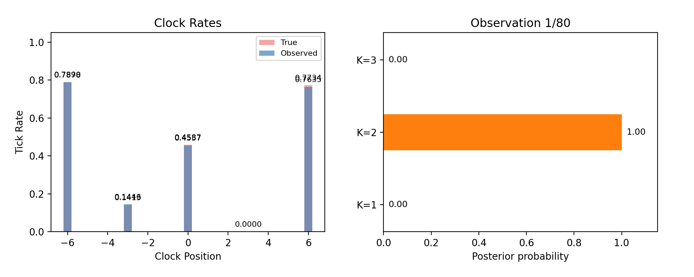

## The question behind the question

Every page so far fixed the number of masses in advance — detection with
the answer key half-open. Real detection must infer the *model*, not just
its parameters. The Bayesian answer is to run a separate particle filter
for each candidate count $K$ and compare **evidence**: the marginal
probability each model assigned to the data. The filter produces an
[estimate of it](../method/the-particle-filter.qmd#sec-evidence) as a
by-product of running, and that estimate carries sampling noise of its own.



One mass is all but ruled out by the first observation. Three masses lead at
first, two take over around the tenth observation, and from about the
twentieth three stay ahead: the run ends at about 40% for two masses and 60%
for three, leaning toward the wrong answer. That is one run's
estimate from finite data and a finite particle cloud, a weak preference
rather than a verdict.

## Occam's razor, automatic

Why should $K=3$ not win automatically? A three-mass model can approximate many
two-mass configurations by pushing the extra mass toward the lower
[prior](../method/notation-and-glossary.qmd#term-prior) bound or into a weakly visible
location. Here that lower bound is strictly positive and positions are bounded,
so the candidate models are not guaranteed to be nested: a larger $K$ need not
have an equally good best fit. Evidence instead
averages the likelihood over the model's whole prior. Extra parameters
spread that average across vast regions of configuration space the data
rejects, and the dilution is the tax. Complexity isn't punished by rule;
it is punished by arithmetic.

## Run it live

(One geometric note: this scenario keeps the second mass at $x = 3.0$,
directly atop a clock — the placement the previous page avoided for
parameter estimation.)

```{python}
#| code-fold: true
#| fig-cap: "Posterior probability of each mass count as observations arrive, in a smaller run executed on this page: 25 observations, 400 particles. Truth is K=2."
import matplotlib.pyplot as plt
import numpy as np
from clocks import (
    ClockArray, InferenceConfig, MassConfig, NoiseConfig,
    PriorConfig, SimulationConfig, infer, simulate,
)

clock_array = ClockArray(
    positions=np.array([[-6.0], [-3.0], [0.0], [3.0], [6.0]]), track_offset=1.0
)
truth = MassConfig(positions=np.array([[-2.0], [3.0]]), masses=np.array([0.045, 0.030]))
sim = simulate(SimulationConfig(
    clock_array=clock_array, ground_truth=truth,
    noise=NoiseConfig(observation_std=0.005), n_observations=25, seed=42,
))
result = infer(sim.observations, InferenceConfig(
    clock_array=clock_array, noise=NoiseConfig(observation_std=0.005),
    prior=PriorConfig(position_range=(-8.0, 8.0), mass_range=(0.005, 0.15)),
    n_particles=400, n_masses=(1, 2, 3),
    ess_target=0.8, rejuvenation_steps=2, proposal_scale=2.38, seed=42,
))

print(f"Posterior over K: { {k: round(v, 3) for k, v in result.posterior_by_model.items()} }")
print(f"Best model: K = {result.best_model}")

fig, ax = plt.subplots()
steps = np.arange(1, len(result.history) + 1)
for k in sorted(result.posterior_by_model):
    ax.plot(steps, [h[k] for h in result.history], label=f"K = {k}")
ax.set_xlabel("observation #")
ax.set_ylabel("posterior probability")
ax.set_ylim(-0.05, 1.05)
ax.legend()
plt.close(fig)
fig
```

::: {.callout-note title="Two runs, two answers"}
This smaller run ends near 74% for two masses; the animation at the top of
the page ends near 40%. They differ in how much data they saw and in how many
particles estimated the evidence, and changing only the inference seed can
move the split between two and three by tens of percentage points. Among the
three counts compared, read both runs as "not one; two or three unresolved".
:::
