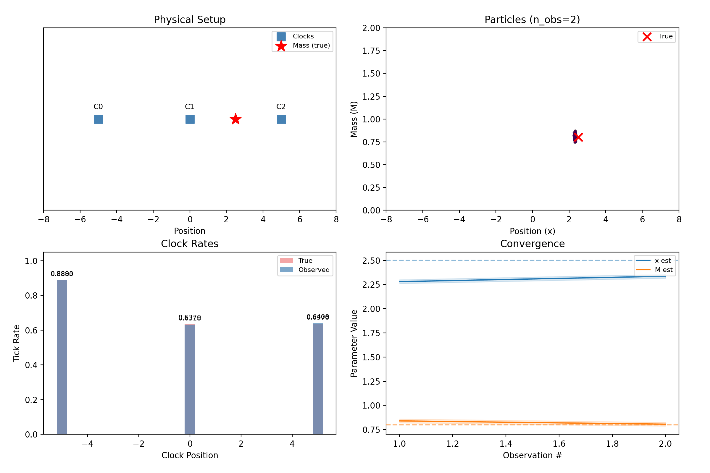

## The setup

Three clocks sit on a line; somewhere on a parallel track hides a single
mass. Two unknowns — position $x$ and mass $M$ — and a stream of noisy tick
rates. Here is the full search, animated:



## Meet the detective

The inference engine is a **particle filter**: a cloud of hypotheses —
one thousand of them in the animation above — each one a guess at
$(x, M)$. Every time a new observation
arrives, each hypothesis is reweighted by how well it predicts the observed
rates. Adaptive likelihood tempering prevents one sharp observation from
destroying the cloud at once; resampling multiplies hypotheses that survive,
and Metropolis-Hastings moves restore diversity while preserving each
tempered target. The weighted cloud approximates the posterior — its spread
is the claimed uncertainty. Mechanics, controls, and failure modes live in
[The Particle Filter](../method/the-particle-filter.qmd).

## Watch it converge

The same scenario, run small and live on this page:

```{python}
#| code-fold: true
#| fig-cap: "Posterior mean ± one standard deviation per observation, position above and mass below. Dashed lines mark the truth: x = 2.5, M = 0.10."
import matplotlib.pyplot as plt
import numpy as np
from clocks import (
    ClockArray, InferenceConfig, MassConfig, NoiseConfig,
    PriorConfig, SimulationConfig, infer, simulate,
)

clock_array = ClockArray(positions=np.array([[-5.0], [0.0], [5.0]]), track_offset=1.0)
truth = MassConfig(positions=np.array([[2.5]]), masses=np.array([0.10]))
sim = simulate(SimulationConfig(
    clock_array=clock_array, ground_truth=truth,
    noise=NoiseConfig(observation_std=0.005), n_observations=25, seed=42,
))
result = infer(sim.observations, InferenceConfig(
    clock_array=clock_array, noise=NoiseConfig(observation_std=0.005),
    prior=PriorConfig(position_range=(-8.0, 8.0), mass_range=(0.005, 0.15)),
    n_particles=400, n_masses=1,
    ess_target=0.8, rejuvenation_steps=2, proposal_scale=2.38, seed=42,
))

steps = np.arange(1, len(result.history) + 1)
means = np.array([entry.mean for entry in result.history])
stds = np.array([entry.std for entry in result.history])
fig, axes = plt.subplots(2, 1, sharex=True)
for j, (ax, label, true_val, color) in enumerate(
    zip(axes, ["position x", "mass M"], [2.5, 0.10], ["tab:blue", "tab:orange"])
):
    ax.plot(steps, means[:, j], color=color)
    ax.fill_between(
        steps, means[:, j] - stds[:, j], means[:, j] + stds[:, j],
        alpha=0.15, color=color,
    )
    ax.axhline(true_val, color=color, ls="--", alpha=0.5)
    ax.set_ylabel(label)
axes[-1].set_xlabel("observation #")
plt.close(fig)
fig
```

## What to notice

The two estimates tighten together. Relative to the true values, the
posterior standard deviation of each is about 10% after the first reading
and about 2% after twenty-five: close to the improvement you would expect
from averaging independent noise, one over the square root of the number of
readings. Neither unknown is the hard one here. The rate profile across the
three clock positions constrains both at once, its shape fixing position and
its depth fixing mass. The bands are the filter's own statement of what the
data have and have not settled, and they matter more when we add
[a second dimension](into-the-plane.qmd).
