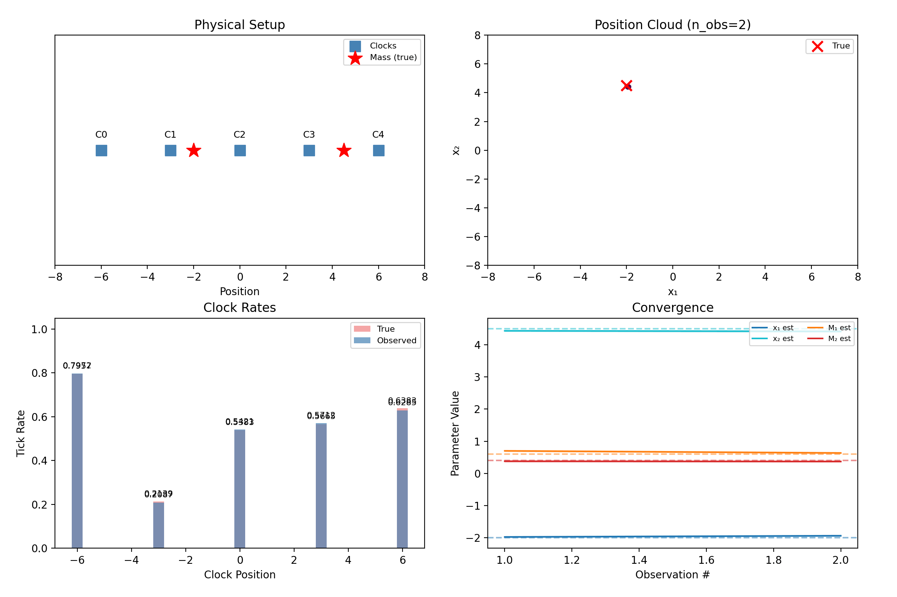
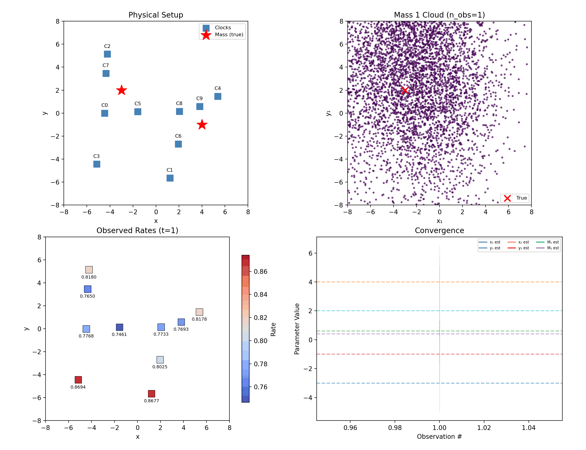

## The problem doubles

Two masses in 1D means four unknowns ($x_1, x_2, M_1, M_2$); on a plane,
six. The potential is just the sum of the two wells, but the inverse
problem gets qualitatively harder, not merely bigger.





Each animation is one simulated run, not a success rate.

## Label switching — an honest limitation

"Mass 1" and "mass 2" are *our* labels; the physics doesn't care. A
hypothesis with the masses swapped predicts identical clock rates, so the
true [posterior](../method/notation-and-glossary.qmd#term-posterior) is perfectly bimodal — and the mean of a bimodal cloud lands
meaninglessly between the modes. The library breaks the tie by naming the
masses in order of their $x$-coordinate, so that $x_1 < x_2$ always, and the
filter's
[moves](../method/the-particle-filter.qmd#sec-resampling) never cross that
line.

What this does **not** solve: when the two masses nearly share an
x-coordinate, the sort boundary slices right through the posterior, and
sampling can become difficult. The 1D demo's
second mass originally sat at $x_2 = 3.0$, exactly on top of a clock and
close enough to cause trouble, and was moved to $4.5$ to keep the demo
crisp. Ordering is an identifiable parameterization, not evidence that the
physical masses have intrinsic labels.

## Superposition is the enemy

Why is this hard at all? Because summed potentials hide their parts — and
the clocks only see the tick rates the summed potential produces:

```{python}
#| code-fold: true
#| renderings: [light, dark]
#| fig-cap:
#|   - "Tick-rate profiles for the two demo masses against a single mass of the combined weight placed between them, with the clocks set back to `track_offset=2.0` so the combined mass stays inside the model's domain. The curves look alike, but at the five marked clock positions they differ by up to about three times the observation noise."
#|   - "Tick-rate profiles for the two demo masses against a single mass of the combined weight placed between them, with the clocks set back to `track_offset=2.0` so the combined mass stays inside the model's domain. The curves look alike, but at the five marked clock positions they differ by up to about three times the observation noise."
import matplotlib.pyplot as plt
import numpy as np
from clocks import ClockArray, MassConfig, clock_rates
from clocks.viz import THEMES, show, style

clock_positions = np.array([[-6.0], [-3.0], [0.0], [3.0], [6.0]])
clock_array = ClockArray(positions=clock_positions, track_offset=2.0)
two_masses = MassConfig(
    positions=np.array([[-2.0], [4.5]]), masses=np.array([0.045, 0.030])
)
one_mass = MassConfig(positions=np.array([[0.6]]), masses=np.array([0.075]))

xs = np.linspace(-8, 8, 300).reshape(-1, 1)
dense = ClockArray(positions=xs, track_offset=2.0)
series = [
    ("two masses (truth)", "o", two_masses),
    ("one combined mass", "s", one_mass),
]
profiles = [clock_rates(config, dense) for _, _, config in series]
readings = [clock_rates(config, clock_array) for _, _, config in series]

for theme in THEMES:
    with style(theme) as colors:
        fig, ax = plt.subplots()
        handles = []
        for (label, marker, _), profile, reading, color in zip(
            series, profiles, readings, (colors.truth, colors.belief)
        ):
            (curve,) = ax.plot(xs[:, 0], profile, color=color)
            (points,) = ax.plot(
                clock_positions[:, 0], reading, marker, color=color,
            )
            handles.append((curve, points))
        ax.set_xlabel("position")
        ax.set_ylabel("tick rate")
        ax.legend(handles, [label for label, _, _ in series])
        show(fig)
```

The curves are close by eye, yet at $x = 0$ this pair and this combined
mass differ by nearly three noise standard deviations in a single reading. A
better-placed single mass comes closer across the array, so one noisy
observation need not settle the question. Repeated independent observations
from all five clocks make the remaining difference easier to resolve.

::: {.callout-note title="The question behind the question"}
This combined mass is a poor impostor for this pair. A better-chosen one
would be harder to catch, and so would three masses posing as two. How would
you ever know *how many* masses are out there? Fixing the number in advance
was quietly cheating.
The [next page](how-many-masses.qmd) stops cheating.
:::
